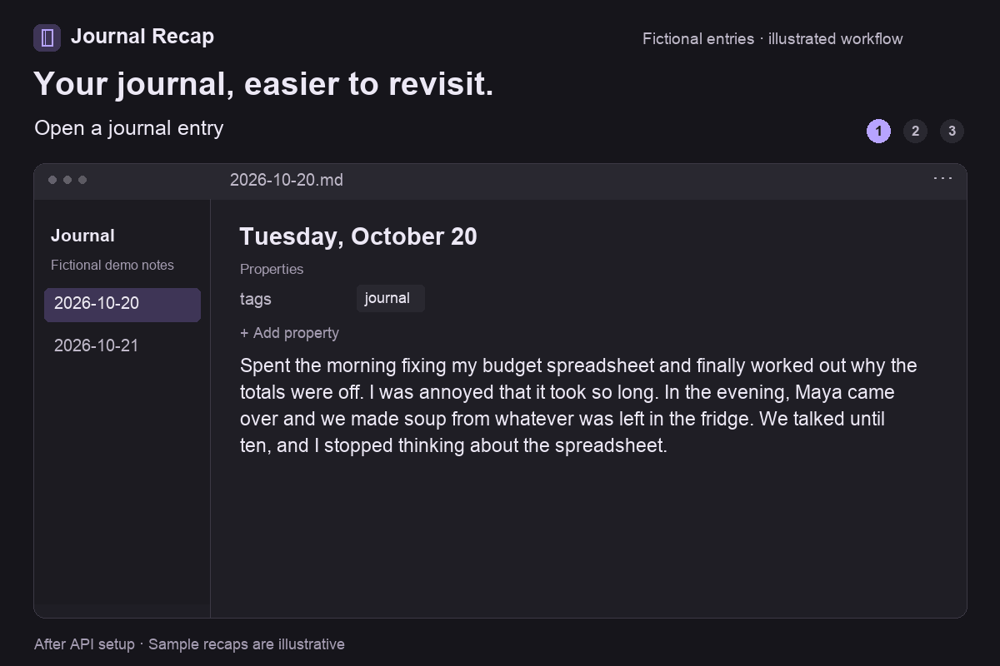

# Journal Recap

Turn a long journal entry into one personal sentence you can revisit later.

Journal Recap is an [Obsidian](https://obsidian.md/) plugin that saves an AI-generated recap in your note's **Properties**, under `summary`. Your journal entry stays intact, and the recap gives you a quick reminder of what mattered that day.

The default prompt aims for a natural, diary-like sentence of about 20–35 words, with concrete details and room for mixed feelings. You choose when to generate it, then review or edit the result yourself.

**Requirements:** Obsidian 1.8.7 or later on desktop, an internet connection, and an API key. The default connection uses OpenAI. API usage is billed separately from ChatGPT subscriptions.

[Install Journal Recap](https://obsidian.md/plugins?id=journal-recap) · [Demo](#demo) · [Setup](#setup) · [Privacy and cost](#privacy-and-cost) · [Get help](#get-help)

## Demo

After [setup](#setup), open an entry, run **Summarize current journal entry**, and read the recap in **Properties**.



An 18-second loop with two fictional entries. The interface and sample recaps are illustrative, not a live recording; actual wording and processing time vary.

[View a still image](docs/assets/journal-recap-demo.png) or read the [before-and-after examples](#before-and-after) below.

## Before and after

These entries and example recaps are fictional. Actual wording varies by entry and model.

### A day with something to keep

**Before:** a journal entry in `2026-10-20.md`.

```markdown
---
tags: [journal]
---
# Tuesday

Spent the morning fixing my budget spreadsheet and finally worked out why the totals were off. I was annoyed that it took so long. In the evening, Maya came over and we made soup from whatever was left in the fridge. We talked until ten, and I stopped thinking about the spreadsheet.
```

Run **Journal Recap: Summarize current journal entry** from the command palette.

**After:** a `summary` property appears above the same entry.

```markdown
---
tags: [journal]
summary: "The budget spreadsheet ate my morning, but making fridge-leftover soup with Maya and talking until ten was the part of the day I wanted to keep."
---
# Tuesday

Spent the morning fixing my budget spreadsheet and finally worked out why the totals were off. I was annoyed that it took so long. In the evening, Maya came over and we made soup from whatever was left in the fridge. We talked until ten, and I stopped thinking about the spreadsheet.
```

Obsidian usually displays this field in **Properties** at the top of the note. The block between `---` lines is the same information in Markdown, called frontmatter.

### A day that stayed frustrating

**Before:** another entry.

> The client sent another round of changes after saying yesterday's version was final. I spent most of the afternoon redoing it and skipped the walk I'd planned. I called my sister after dinner. She made me laugh, but I'm still irritated and tired.

**After:** the example `summary` property, with the entry body preserved.

```yaml
summary: "Another supposedly final revision swallowed my afternoon and the walk I'd planned, and even laughing with my sister after dinner didn't quite shake the irritation."
```

## Setup

### 1. Install and enable

1. Open Obsidian on desktop and go to **Settings → Community plugins**.
2. If community plugins are disabled, select **Turn on community plugins**.
3. Select **Browse**, search for **Journal Recap**, then select **Install** and **Enable**.

You can also open the [community listing](https://obsidian.md/plugins?id=journal-recap). For a downloaded release, see [Manual installation](#manual-installation).

### 2. Connect your API account

1. Sign in to the [OpenAI API platform](https://platform.openai.com/) and make sure your API account has available billing or credits.
2. Create a key on the [API keys page](https://platform.openai.com/api-keys). OpenAI's [getting started guide](https://developers.openai.com/api/docs/quickstart) explains API-key setup.
3. In Obsidian, open **Settings → Journal Recap** and paste the key into **API key**.
4. For your first recap, keep **Base endpoint** at `https://api.openai.com/v1` and **Model** at the plugin default, `gpt-4o-mini`. Leave **Use custom request template** off.
5. Select **Test API call**. A successful test displays when the key was tested. If you see an error, check [Troubleshooting](#troubleshooting) before continuing.

The test sends a short test message rather than your journal entry. It makes a real API request and may incur a charge.

### 3. Generate your first recap

1. Open a Markdown note with journal text. You can copy a fictional entry above to try it first.
2. Open the command palette with **Ctrl+P** on Windows/Linux or **Cmd+P** on macOS.
3. Search for and run **Journal Recap: Summarize current journal entry**.
4. Wait for the **Summarized.** notice, then look for `summary` in the note's **Properties**. Read it and edit it if needed.

The command works on the active Markdown note; no special folder, filename, template, or Daily Notes setup is required. It processes one entry each time you run it. You can assign a shortcut in **Settings → Hotkeys** by searching for **Journal Recap**.

Running the command again replaces the existing `summary`. With the default settings, other properties and the entry body are preserved.

## Use recaps for a journal review

At the end of the week, skim your recaps and open the entries you want to revisit. Here is a fictional overview:

| Entry | Recap |
| --- | --- |
| October 20 | The budget spreadsheet ate my morning, but making fridge-leftover soup with Maya and talking until ten was the part of the day I wanted to keep. |
| October 21 | Another supposedly final revision swallowed my afternoon and the walk I'd planned, and even laughing with my sister after dinner didn't quite shake the irritation. |
| October 22 | Clearing one desk drawer led to finding my old sketchbook, and I spent a quiet hour drawing instead of trying to finish everything else. |

Journal Recap saves the individual summaries. To display them together, you can set up an [Obsidian Bases table](https://help.obsidian.md/bases), filter it to your journal folder, and show the note name and `summary` property. That overview needs separate setup; the plugin does not create it for you.

## Privacy and cost

- **What is sent:** when you run the summary command, the active note's text, excluding its frontmatter, is sent to the configured endpoint with the prompt and output schema. The default endpoint is OpenAI.
- **When requests happen:** summaries run on your command. **Test API call** sends a short test message to the same endpoint. There is no automatic background summarization or telemetry.
- **What is saved:** the generated recap is written into the note's Properties. Your API key, endpoint, model, prompt, schema, and API-test timestamp are saved in this vault's plugin data. Treat those settings as private when sharing or syncing vault files.
- **Provider retention:** requests include `store: false`. This does not guarantee zero data retention; the endpoint provider's policies still apply. See [OpenAI's data controls](https://developers.openai.com/api/docs/guides/your-data) before sending sensitive entries.
- **Cost:** OpenAI requires an API account with available billing or credits. A ChatGPT subscription does not cover this plugin's API calls. Charges depend on the model and amount of text; see [OpenAI API pricing](https://developers.openai.com/api/docs/pricing).

## Customize your recaps

The defaults are enough to start. To change the recap's voice or focus, open **Settings → Journal Recap → Advanced** and enable **Use custom request template**.

- **Custom prompt template** controls the instructions given to the model. For example, ask for a plainer tone or more focus on the day's relationships.
- **Custom output schema** controls which properties are returned. Leave it unchanged if you only want to change the writing style. Returned properties replace existing properties with matching names.
- Use each field's **Restore default** button to reset it, or turn off **Use custom request template** to use the default prompt and schema again.

You can also change **Model** or **Base endpoint** under **Connection**. A custom provider must support the Responses API and the structured-output request format this plugin uses. Support for Chat Completions alone is not enough.

## Troubleshooting

| Problem | What to check |
| --- | --- |
| The command is missing | Enable **Journal Recap** in **Settings → Community plugins**, then search the command palette again. The plugin currently supports desktop only. |
| **Add an API key in settings first.** | Enter your key in **Settings → Journal Recap → API key**. |
| **No journal content found.** | Open a Markdown note with text below its Properties. An empty note or one containing only frontmatter has no entry to summarize. |
| The API test or summary returns an error | Check your key, API billing or credits, network connection, model access, and endpoint. **Test API call** helps check the connection without sending a journal entry. |
| The request fails with a custom provider | Confirm that the provider supports Responses requests and structured outputs. Restore the default prompt and schema to rule out custom-template issues. |
| The summary is hard to find | Look for `summary` in the note's **Properties**, or switch the editor to **Source mode** to inspect the frontmatter. |
| The wording misses something important | Edit the property yourself, or adjust the custom prompt and run the command again. Review generated recaps before relying on them. |

## Manual installation

1. Download `main.js`, `manifest.json`, and `styles.css` from the [latest release](https://github.com/aegerita/journal-recap/releases/latest).
2. Create a `journal-recap` folder inside your vault's `.obsidian/plugins/` folder and copy all three files into it:

   ```text
   VaultFolder/.obsidian/plugins/journal-recap/
   ```

3. Restart Obsidian, then enable **Journal Recap** in **Settings → Community plugins**.
4. Follow [Setup](#setup) to connect your API account and generate a recap.

## Get help

For a bug or suggestion, [open an issue](https://github.com/aegerita/journal-recap/issues). Include your Obsidian and plugin versions, model, endpoint provider, steps to reproduce, and error message. Use a fictional entry when an example is needed, and leave out API keys and private journal text.

For development, testing, and release instructions, see [CONTRIBUTING.md](CONTRIBUTING.md).

## Credits and license

Journal Recap is based on [Auto Classifier](https://github.com/HyeonseoNam/auto-classifier) by [Hyeonseo Nam](https://github.com/HyeonseoNam).

This project uses the Dynalist permissive license included in [LICENSE](LICENSE).
